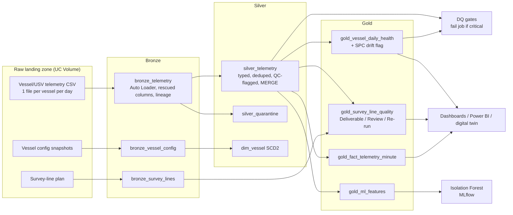

# Marine Geodata Lakehouse

**A Databricks medallion pipeline that turns raw vessel and survey telemetry into governed, AI-ready data products, and proves its own data quality.**

Uncrewed vessels and remote operations only cut cost if the data coming off them can be trusted quickly. This project shows the data-engineering layer that makes that possible: incremental ingestion, schema-drift handling, SPC-style quality control, an SCD Type 2 dimension, Gold data products, an MLflow anomaly model, and data-quality gates that fail the job before bad data reaches anyone.

> All data is **synthetic** and every vessel and project name is fictional. Faults are injected on purpose and logged, so the QC can be scored against known answers.

---

## Architecture



| Layer | What happens | Why it matters |
| --- | --- | --- |
| **Bronze** | Auto Loader ingests only new files; agreed columns as text; unexpected columns kept in `_rescued_data`; source file and ingest time on every row | Replayable history; a firmware change never breaks the pipeline or loses data |
| **Silver** | Types and UTC timestamps; knots to m/s; quarantine unparseable rows; de-duplicate re-sent files; QC flags for range, spike, flatline and gap; MERGE upsert; SCD2 vessel config | One trusted version of each reading, with every exclusion explainable |
| **Gold** | Daily vessel health with SPC drift check; survey-line delivery verdict; 1-minute fact table on QC-passed values; ML features | Products a person or model can use without re-cleaning |
| **ML** | Isolation Forest on raw-signal windows, time-based split, tracked in MLflow | Second opinion for patterns no rule was written for |
| **DQ gates** | QC recall vs fault log, duplicate-key and completeness checks, history in `dq_results` | The job fails loudly instead of publishing bad data |

---

## Results (local run, 7 days × 3 vessels, 189,810 raw rows)

| Fault injected | Count | Caught by | Detected |
| --- | --- | --- | --- |
| Echo-sounder depth spikes | 126 | Silver spike rule | 126 (100%), 0 false alarms |
| Motion-sensor sentinel (roll = 999) | 21 | Silver range rule | 21 (100%) |
| Stuck temperature sensor (2 h) | 1 | Silver flatline rule | 1 (120 min flagged) |
| Comms dropout (45 min) | 1 | Silver gap rule | 1 |
| Temperature calibration drift (+1.5 °C, 2 days) | 2 vessel-days | Gold SPC fleet-relative X-bar check | 2, 0 false alarms |
| Re-sent duplicate file | 8,638 rows | Silver de-duplication | All removed, 0 duplicate keys remain |
| Malformed timestamps | 44 rows | Silver quarantine | All quarantined |
| New firmware column `battery_pct` | 51,840 rows | Bronze rescue → Silver | Recovered, no pipeline failure |

**Business output:** of 42 planned survey lines, 41 are *Deliverable* and 1 is flagged *Re-run* (USV-02 line during the comms dropout: 81% complete). That is the decision that matters: re-run it while the vessel is still on site.

**Anomaly model (honest result):** on the test days the Isolation Forest reached 0.73 precision and 0.66 recall at window level, while the rules reached 1.00 and 1.00. For faults you already know, rules win; the model's role is to surface unknown patterns for a human to review, then become a new rule.

---

## Before vs After

| | Before (manual) | After (this pipeline) |
| --- | --- | --- |
| Finding bad readings | Analyst scrolls logs per vessel per day | Every reading flagged automatically with a reason |
| Duplicate or re-sent files | Spotted by chance, double counting | Removed by key, provably zero duplicates |
| Firmware/schema changes | Pipeline breaks or columns silently dropped | Captured in `_rescued_data`, surfaced in Silver |
| Sensor drift | Noticed weeks later, data re-processed | Flagged the same day by SPC check |
| Incomplete survey line | Found after demobilisation, vessel re-mobilised | Flagged within the daily run, re-run on site |
| Trust in the numbers | "Who ran this?" | DQ gate history in `dq_results`, job fails on critical issues |

**ROI framing (illustrative, replace with real figures):**
* Analyst QC time saved per year ≈ vessels × operating days × manual QC hours per vessel-day.
  Example: 3 × 300 × 1.5 h = **1,350 h/year**.
* Re-mobilisation avoided per year ≈ incomplete lines caught on site × cost of a vessel day.
  Even one avoided re-mobilisation usually outweighs the cost of the pipeline.

---

## Run it

### Option A: Databricks Free Edition (no cost)
1. Sign up for Databricks Free Edition and open your workspace.
2. Push this repo to GitHub, then in Databricks: **Workspace → Create → Git folder** and paste the repo URL.
3. Open `notebooks/00_setup.py` and run notebooks `00` to `06` in order (serverless compute, defaults `catalog=workspace`, `schema=marine_geodata`).
4. Browse the tables in **Catalog**, the run in **Experiments**, and paste `dashboards/queries.sql` into a SQL editor or AI/BI dashboard.

### Option B: as code with Databricks Asset Bundles
```bash
databricks auth login --host https://YOUR-WORKSPACE.cloud.databricks.com
# edit the host in databricks.yml, then:
databricks bundle validate
databricks bundle deploy -t dev
databricks bundle run geodata_pipeline -t dev
```

### Option C: locally, no Databricks
```bash
pip install -r requirements-dev.txt     # needs Java 17+
pytest -q                               # 9 unit tests
python scripts/run_local.py             # full pipeline, Parquet in place of Delta
```

CI (`.github/workflows/ci.yml`) runs the tests and the local pipeline on every pull request, and deploys the bundle to `dev` on merge to `main`.

---

## Repository layout

```
databricks.yml                 Asset Bundle: job with 7 tasks, dev/prod targets
src/geodata/
  config.py                    All QC thresholds and rules in one reviewed place
  generator.py                 Synthetic raw files + fault log
  bronze.py                    Lineage + schema rescue (local stand-in for Auto Loader)
  silver.py                    Standardise, quarantine, dedupe, QC rules, SCD2
  gold.py                      Daily health + SPC drift, line verdicts, fact table, ML features
  ml.py                        Isolation Forest, time-based split, labelling
  quality.py                   QC recall scoring, DQ gates
notebooks/00..06               Thin Databricks notebooks calling src/geodata
dashboards/queries.sql         KPI, exceptions, line verdicts, map, DQ history
tests/test_transforms.py       Unit tests for every QC rule, dedupe, rescue, SCD2
scripts/run_local.py           End-to-end local run
```

## Design decisions

* **Logic in a package, notebooks thin.** The same functions run in notebooks, CI and unit tests.
* **Flag, don't delete.** Silver keeps every reading with `qc_flags`; each Gold product decides per sensor what is usable.
* **Spike baseline excludes the current value** and is only judged with at least 10 prior readings and no gap just before, which removed the false alarms at the start of the campaign and after dropouts.
* **Drift is fleet-relative.** Vessels in the same water should read the same temperature; comparing each to the fleet median removes the daily cycle and isolates sensor error.
* **ANSI-safe parsing** (`try_to_timestamp`, `try_cast`) so one bad row is quarantined instead of failing the job.

## Limitations and next steps

* Synthetic data; thresholds would be tuned on real sensor history.
* Silver recomputes rolling windows over the whole Bronze table; at production scale, process by date with a one-hour look-back.
* Next: Lakeflow Declarative Pipelines expectations, Unity Catalog row filters by client project, streaming for live vessel alerts, and a Microsoft Fabric version reading the Gold tables through OneLake shortcuts.
